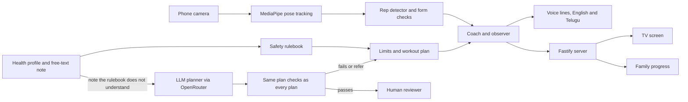

# RayaPlay

A camera-based exercise coach for the whole family. The phone watches you move, counts your reps, corrects your form and talks you through the workout in English or Telugu. Games controlled by your body make it fun for kids, and a safety rules engine keeps every plan appropriate for the person doing it.

> This repo is a public showcase (architecture, design decisions, evaluation approach). The source code is private. Happy to walk through it on a call.

## What it does

- **Pose-based coaching:** MediaPipe pose tracking in the browser, a rep detector, form checks and a coach that observes and speaks. Curls, presses and squats, plus weighted moves such as lateral raises, front raises and rows.
- **Gentler variants:** a lower press, a chair squat and fully seated routines, chosen from the person's health profile.
- **Body-controlled games:** fruit slicing, balloons, dash, duel, pilot and drawing, driven by pose and hand tracking.
- **Two languages:** English and Telugu spoken lines, pre-recorded with neural voices through a generation script, so the app speaks without a network call.
- **Family features:** progress shared between phones, and a TV mode where the phone sends the workout state to a big screen through the server.
- **Installable web app:** PWA with a service worker, and Android packaging drafted as a Trusted Web Activity.

## Architecture

## The interesting part: an LLM that cannot override safety

People describe their health in their own words, and a fixed rulebook cannot understand every note. RayaPlay uses an LLM only for notes the rulebook does not understand, and never trusts it:

1. The model must return JSON that matches a strict schema: a refer-to-doctor flag, a short reason and a routine of allowed moves, sets, reps and variants.
2. The proposal is checked by the same code that checks every plan. A plan that breaks any limit is rejected.
3. If the note describes a symptom, the model can say to see a doctor first and no routine is produced.
4. If the model cannot be reached, or returns bad JSON, the app falls back to the cautious built-in plan.

## Key design decisions

| Decision | Why |
|---|---|
| **Rules only ever tighten limits** | The most cautious rule always wins, no matter how many rules apply. |
| **Validate model output with deterministic code** | The LLM proposes, the rulebook disposes. A model mistake cannot reach a user. |
| **Everything runs on the phone where possible** | Pose tracking and rep counting happen in the browser, so video never leaves the device. |
| **Validated TV messages** | The server validates every message from a phone with a strict parser before the TV receives it, and the TV shows all of it as plain text. |
| **Pre-recorded voice** | Fixed neural-voice clips are generated once, which keeps the app fast and working offline. |

## How it is evaluated

- **Hundreds of automated tests** across the app and the server: rep detection, health rules, voice, the TV protocol, security limits and more.
- **An independent oracle:** a second statement of the safety rules, written from the plain-language spec rather than from the rules code. Random people and random plans are checked against both. If they ever disagree, one of them is wrong.
- **Mutation checks:** safety-critical code is broken on purpose, one change at a time (for example an age threshold moved by one). If no test fails, a test is missing or too weak.
- **Model comparison:** a script runs unusual, made-up health notes through different OpenRouter models and scores each one with the same checks the app uses. No real person's data is sent.

## Tech stack

TypeScript, Vite, MediaPipe Tasks Vision, Three.js, Fastify, OpenRouter (LLM), edge-tts (voice generation), service worker PWA, Node test runner.

## Contact

Hemesh Raya | [LinkedIn](https://www.linkedin.com/in/hemesh-raya-a6746b1a2/)
